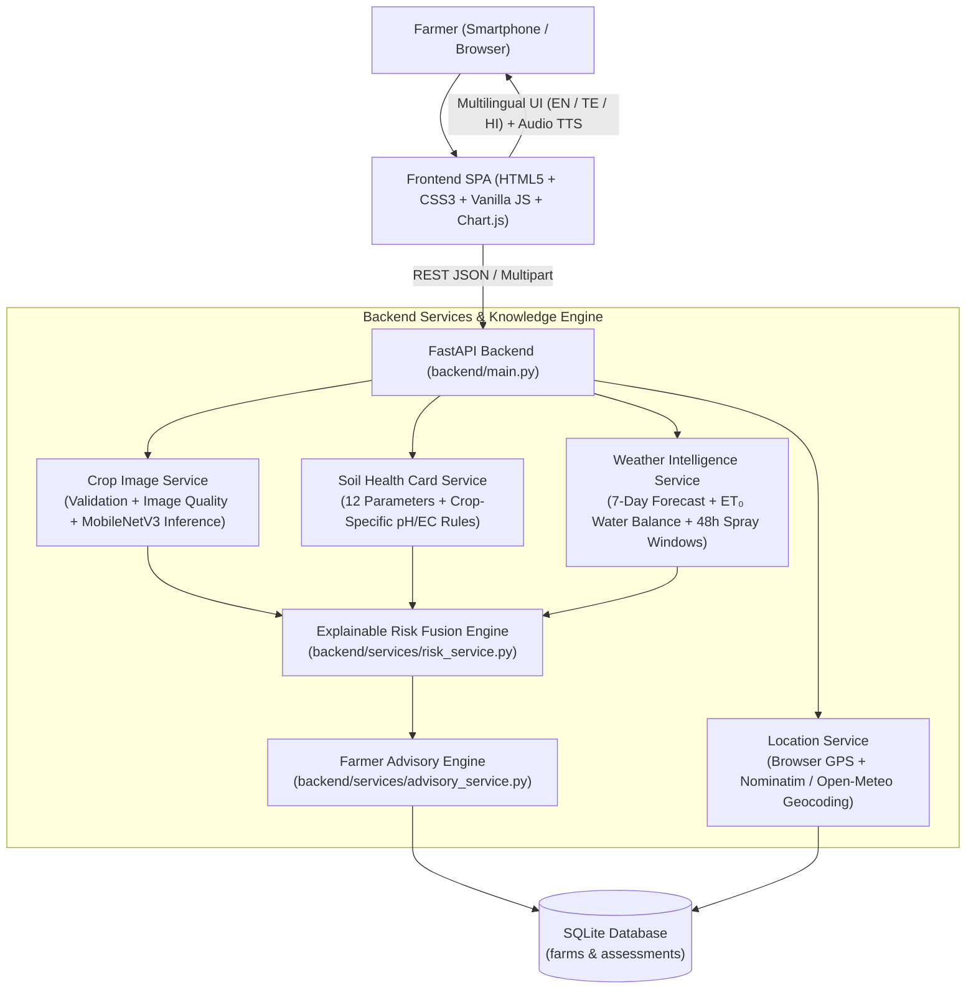

# Smart Crop Advisory System for Small and Marginal Farmers

An end-to-end, smartphone-friendly agricultural decision-support platform designed specifically for small and marginal farmers. It combines **leaf disease classification (MobileNetV3 / EfficientNet-B0)**, **Government Soil Health Card interpretation**, **farm-specific weather intelligence (Open-Meteo)**, an **explainable crop-risk engine**, and **practical, low-cost farmer advisories** in **English, Telugu (తెలుగు), and Hindi (हिन्दी)**.

---

## 1. Architecture Overview



---

## 2. Project Directory Structure

```text
SMART CROP ADVISORY SYSTEM/
├── backend/
│   ├── main.py                      # FastAPI application & API routes
│   ├── schemas.py                   # Pydantic request/response validation models
│   ├── database/
│   │   ├── database.py              # SQLite connection & table initialization
│   │   └── models.py                # CRUD functions for farms & assessments
│   ├── knowledge/
│   │   ├── crops.py                 # Crop pH, salinity, & temperature profiles
│   │   ├── diseases.py              # Disease descriptions, microclimate rules, cultural actions
│   │   └── soil_reference.py        # Indian Soil Health Card limits & explanations
│   ├── ml/
│   │   ├── dataset.py               # PlantVillage folder discovery & stratified splits
│   │   ├── download_dataset.py      # Dataset helper / verification script
│   │   ├── evaluate.py              # Test-set evaluation, confusion matrix & threshold calibration
│   │   ├── labels.py                # Class-name parser (crop + disease mapping)
│   │   ├── model_def.py             # MobileNetV3 / EfficientNet-B0 transfer learning builder
│   │   ├── predict.py               # Lazy-loaded PyTorch inference wrapper
│   │   ├── preprocess.py            # Resize, normalization, augmentation & blur/lighting check
│   │   ├── train.py                 # 2-phase transfer-learning training script
│   │   └── model/                   # Saved model weights & evaluation reports
│   ├── services/
│   │   ├── advisory_service.py      # Farmer-friendly advisory & TTS summary generator
│   │   ├── crop_service.py          # Upload validation, quality checks, uncertainty handling
│   │   ├── location_service.py      # Village search & reverse geocoding
│   │   ├── risk_service.py          # Explainable multimodal risk scoring engine
│   │   ├── soil_service.py          # 12-parameter Soil Health Card analyzer
│   │   └── weather_service.py       # Open-Meteo forecast, ET₀ balance & spray-window finder
│   └── utils/
│       └── validators.py            # File type, size, image integrity & coordinate validators
├── frontend/
│   ├── index.html                   # Single-page responsive interface
│   ├── css/
│   │   └── styles.css               # Agricultural UI theme & mobile layout
│   └── js/
│       ├── i18n.js                  # English, Telugu & Hindi translations
│       └── app.js                   # Frontend API integration, charts, TTS & WhatsApp copy
├── tests/
│   └── test_api_and_services.py     # Automated pytest suite for API & services
├── pytest.ini
├── requirements.txt
└── README.md
```

---

## 3. Setup and Execution Instructions

### Step 1: Activate the Virtual Environment
From the project root in PowerShell:
```powershell
.\venv\Scripts\Activate.ps1
```

### Step 2: Install Dependencies (if setting up on a teammate's machine)
```powershell
# Install PyTorch with CUDA 12.8 support (or CPU fallback)
.\venv\Scripts\python.exe -m pip install torch torchvision --index-url https://download.pytorch.org/whl/cu128

# Install FastAPI, scikit-learn, matplotlib, pytest, etc.
.\venv\Scripts\python.exe -m pip install -r requirements.txt
```

### Step 3: Train the Crop Disease Model on PlantVillage (Kaggle)
1. Download the **PlantVillage Dataset** from Kaggle (for example, [`emmarex/plantdisease`](https://www.kaggle.com/datasets/emmarex/plantdisease) or [`abdallahalidev/plantvillage-dataset`](https://www.kaggle.com/datasets/abdallahalidev/plantvillage-dataset)) and extract it into `backend/ml/dataset/` (or any folder on disk).
2. Run the two-phase transfer learning script (`MobileNetV3-Large` pretrained on ImageNet):
```powershell
.\venv\Scripts\python.exe -m backend.ml.train --data-dir "backend/ml/dataset" --crops tomato potato pepper --epochs 8 --freeze-epochs 2
```
- **What `train.py` produces in `backend/ml/model/`**:
  - `crop_disease_model.pt` — Trained weights, class metadata, and calibrated confidence threshold.
  - `metrics.json` — Held-out test accuracy, macro/weighted F1, per-class precision/recall, and confidence threshold analysis.
  - `classification_report.txt` — Full scikit-learn classification report.
  - `confusion_matrix.png` — Visual confusion matrix across all classes.
  - `training_curves.png` — Train vs. validation loss and accuracy curves.

### Step 4: Start the FastAPI Backend & Open the Application
```powershell
.\venv\Scripts\uvicorn.exe backend.main:app --reload
```
- **Web Application UI**: Open **http://127.0.0.1:8000/app/** in your browser (or open `frontend/index.html` directly).
- **Swagger API Documentation**: Open **http://127.0.0.1:8000/docs**.

### Step 5: Run Automated Tests
```powershell
.\venv\Scripts\python.exe -m pytest -v
```

---

## 4. Key Features Built for Small & Marginal Farmers

1. **Farm Location & Profile Manager**:
   - Supports both **1-click phone GPS** (with reverse geocoding to village/district/state) and **manual village/mandal search** across India via OpenStreetMap Nominatim + Open-Meteo fallback.
2. **Pre-Inference Photo Quality & Foliage Inspector**:
   - Automatically checks uploaded leaf photos for darkness, glare, motion blur (Laplacian variance), and foliage coverage before running the neural network, guiding farmers to retake unclear photos.
3. **Calibrated Uncertainty & Crop-Mismatch Detection**:
   - Clearly separates **Healthy**, **Predicted Disease**, **Uncertain Result** (low probability or narrow top-1/top-2 margin), and **Unsupported Crop** instead of forcing a false diagnosis.
4. **Agronomically Grounded 12-Parameter Soil Health Card Analyzer**:
   - Evaluates N, P, K, OC, pH, EC, S, Zn, Fe, Cu, Mn, and B using official Indian Soil Health Card rating limits and DTPA micronutrient critical limits, adjusted for crop-specific pH and salt sensitivity. Works with both full and partial cards.
5. **48-Hour Spray Window Finder & 3-Day Crop Water Balance (Rain vs. ET₀)**:
   - Identifies calm, rain-free daytime windows (wind 2–15 km/h, temp ≤ 30°C, low rain risk) so farmers don't waste labour or sprays before rain, and compares 3-day forecast rain against FAO-56 evapotranspiration ($\text{ET}_0$).
6. **Multilingual Interface + Audio Advisory (TTS) + WhatsApp Share**:
   - Instant switching between **English**, **Telugu (తెలుగు)**, and **Hindi (हिन्दी)**, built-in **Text-to-Speech audio readout** for farmers with limited literacy, **1-click WhatsApp/SMS copy**, and **Kisan Call Centre (1800-180-1551)** integration.
